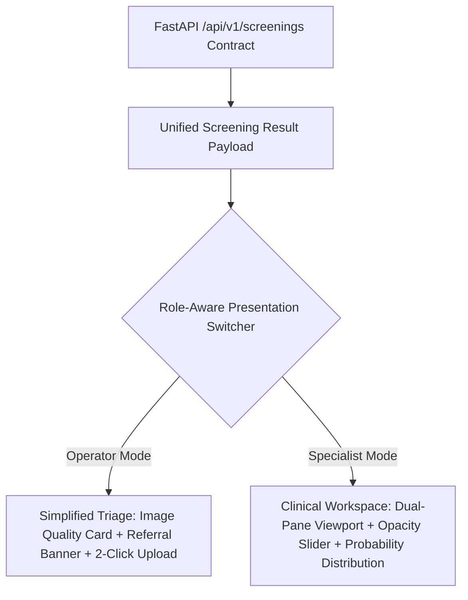

# EYERIS — Reusable Component Specifications & Architecture (Revision 1)
**Subsystem**: UI/UX Component Engineering  
**Role**: Senior Product Designer & Design Systems Engineer (Member 4)  
**Project**: EYERIS — Explainable AI Diabetic Retinopathy Screening System  
**Date**: November 16, 2026  
**Status**: Revised Specification Incorporating Member 4 Approved Design Decisions  

---

## 1. Member 4 Approved Design Decisions

This revised component architecture integrates the following governance rules:
1. **Primary Showcase Component**: Elevates the **Dual-Pane Retinal Image Viewer (`DualImageViewer.jsx`)** as the primary interactive and technical centerpiece.
2. **Anatomical Visibility Guarantee**: Ensures raw preprocessed fundus images remain accessible regardless of active overlays via continuous opacity control ($0–100\%$), side-by-side viewports, and spacebar raw reveal.
3. **Causality Guardrail**: Explicitly annotates Grad-CAM components with a mandatory notice stating that activation maps indicate feature correlation density, not anatomical lesion causality.
4. **Distinct Component States**: Provides dedicated, decoupled UI components for:
   - *State A: Model Unavailability* (`ModelOfflineAlert.jsx`)
   - *State B: Image Quality Failure* (`QualityWarningModal.jsx`)
   - *State C: High Model Uncertainty* (`UncertaintyAlertBadge.jsx`)
   - *State D: Clinical Referral Guidance* (`ReferralBanner.jsx`)
5. **Multi-Channel Accessibility**: Color is never used alone (WCAG 1.4.1); every clinical severity component combines an icon shape, a text label, and a numeric grade.
6. **Provisional Engineering Values**: Quality threshold 0.60 and uncertainty threshold 0.35 are documented as configurable parameters, not certified clinical standards.
7. **Role-Aware Presentation**: Operator Mode and Specialist Mode toggles adapt component density and layout without modifying the underlying decision engine.

---

## 2. Retinal Image Viewer Architecture (`DualImageViewer.jsx`) — PRIMARY TECHNICAL SHOWCASE

### 2.1 Viewport Wireframe & Layout Geometry
```
+---------------------------------------------------------------------------------------------------------+
| [Viewport Toolbar: Height 42px]                                                                         |
| Layer: [ (•) Grad-CAM Heatmap   ( ) Lesion Masks   ( ) Raw Fundus ]                                     |
| Opacity: [----------●-----] [Ex: 70%] | Zoom: [ - ] [Ex: 100%] [ + ] | [ ⟲ Reset ] | [ ↔ Side-by-Side ]  |
+---------------------------------------------------+-----------------------------------------------------+
| PANE A: True-Color Fundus Reference               | PANE B: AI Explainability Layer                     |
|                                                   |                                                     |
|                                                   |                                                     |
|             True-Color Preprocessed Fundus        |             Grad-CAM Attention Heatmap              |
|             (Macula & Optic Disc)                 |             (Class 4 / Neovascularization)          |
|                                                   |             Overlaid with 70% Opacity               |
|                                                   |                                                     |
|                                                   |                                                     |
+---------------------------------------------------+-----------------------------------------------------+
| [Notice: Grad-CAM heatmaps visualize feature activation density and do not establish anatomical causality]|
| (Press-and-Hold Spacebar to momentarily drop Pane B opacity to 0% and reveal raw fundus photograph)     |
+---------------------------------------------------------------------------------------------------------+
```

### 2.2 Viewport Feature Prioritization Matrix

| Viewport Capability | Architectural Description | Priority | Clinical & Technical Justification |
| :--- | :--- | :---: | :--- |
| **Grad-CAM Opacity Slider** | HTML5 range input ($0\% - 100\%$) controlling overlay canvas alpha | **Critical (First Release)** | Eliminates visual occlusion; allows clinicians to verify whether heatmaps align with true vascular lesions. |
| **Press-and-Hold Spacebar** | Keydown event listener temporarily dropping overlay alpha to 0% | **Critical (First Release)** | Enables instant visual flicker-comparison between the AI heatmap and the raw anatomical image. |
| **Synchronized Pan & Zoom** | Bi-directional canvas matrix transform linking Pane A and Pane B | **High (Phase 2)** | Guarantees exact anatomical cross-referencing during deep lesion inspection. |
| **Multi-Lesion Mask Toggles**| Independent checkboxes for exudates, hemorrhages, and microaneurysms | **High (Phase 2/3)** | Allows clinicians to isolate specific lesion classes without visual clutter. |
| **Window/Level Contrast** | Radiologist-style contrast curve adjustments | **Deferred (Post-MVP)** | Not essential for initial prototype screening demonstration. |
| **Measurement Calipers** | Digital millimeter lesion measurement calipers | **Deferred (Post-MVP)** | Requires physical camera sensor calibration parameters. |

---

## 3. Decoupled Clinical & System State Components

```
+---------------------------------------------------------------------------------------------------------+
|                                    DECOUPLED ARCHITECTURAL STATE MATRIX                                 |
+--------------------------+-----------------------+------------------------+-----------------------------+
| STATE A: MODEL OFFLINE   | STATE B: QUALITY FAIL | STATE C: HIGH UNCERTAIN| STATE D: CLINICAL REFERRAL  |
+--------------------------+-----------------------+------------------------+-----------------------------+
| • Model weights pending  | • Quality score < 0.60| • Uncertainty > 0.35   | • ICDR Grade 2, 3, or 4     |
| • Referral: FALSE        | • Referral: FALSE     | • Referral: TRUE       | • Referral: TRUE            |
| • Review Required: TRUE  | • Grading Halted      | • Urgency: Urgent Rev  | • Tiered Clinical Timeframe |
| • Urgency: Manual Review | • Urgency: Recapture  | • Specialist Arbitrate | • Routine / Prompt / Urgent |
+--------------------------+-----------------------+------------------------+-----------------------------+
```

### 3.1 State A: Model Unavailability Component (`ModelOfflineAlert.jsx`)
- **Trigger**: Real model weights missing (`ai_models/classifier/weights/` unharvested).
- **Presentation**: Amber status badge `[⏸] Manual Review Required` + Information Card: *"Automated classification model is currently offline. Case queued for manual ophthalmologist grading. No referral decision generated."*
- **Clinical Safety Rule**: Prevents unassessed cases from polluting hospital referral queues.

### 3.2 State B: Image Quality Failure Modal (`QualityWarningModal.jsx`)
- **Trigger**: `overall_quality_score < 0.60` (provisional engineering threshold) or `is_gradable == False`.
- **Presentation**: High-contrast amber modal `[⚠] Image Quality Insufficient for Automated Grading`.
- **Content**: Specific defect breakdown (e.g. *"Severe corneal reflection / optical blur"*) + Action button: `[ Recapture Retinal Photograph ]`.
- **Clinical Safety Rule**: Halts automated classification to prevent ungradable scans from generating false reassurance.

### 3.3 State C: Model Uncertainty Alert (`UncertaintyAlertBadge.jsx`)
- **Trigger**: Epistemic uncertainty score $>0.35$ (provisional engineering threshold) or `is_uncertain == True`.
- **Presentation**: Violet badge `[🛡] High Model Uncertainty Detected`.
- **Content**: Telemetry card displaying temperature-calibrated probability alongside an explicit uncertainty margin.
- **Clinical Safety Rule**: Flags borderline or ambiguous cases for specialist human confirmation.

### 3.4 State D: Clinical Referral Banner (`ReferralBanner.jsx`)
- **Trigger**: Verified ICDR Grade $\ge 2$ with adequate image quality.
- **Presentation**: Tiered referral card:
  - *Grade 4 (PDR)*: Crimson `[⯄] URGENT SPECIALIST REFERRAL (1–2 Weeks)` — High risk of severe vision loss.
  - *Grade 3 (Severe NPDR)*: Orange `[▲] PROMPT OPHTHALMOLOGY REFERRAL (2–4 Weeks)`.
  - *Grade 2 (Moderate NPDR)*: Amber `[◆] ROUTINE CLINICAL REFERRAL (4–8 Weeks)`.
  - *Grade 0 / 1 (Normal / Mild)*: Emerald `[●] ROUTINE ANNUAL SCREENING`.

---

## 4. Role-Aware Presentation Modes (Operator vs. Specialist)

Both modes consume the exact same underlying pipeline contract from `/api/v1/screenings`:



- **Operator Presentation**: Optimized for rural community health nurses. Prioritizes rapid in-chair quality validation and straightforward referral instructions.
- **Specialist Presentation**: Optimized for ophthalmologists. Unlocks synchronized viewports, Grad-CAM attention controls, lesion counts, and calibrated epistemic uncertainty.

---

## 5. Form & Dropzone Components

### 5.1 Retinal Image Dropzone (`ImageDropzone.jsx`)
- **Drop Target**: 220px height, 2px dashed border (`--eyeris-border-strong`), radial camera vignette background.
- **Pre-Upload Validation**: Checks MIME type (`image/jpeg`, `image/png`) and file size ($\le 15$ MB). Displays instant file thumbnail, pixel dimensions, and clear remove button prior to API submission.

### 5.2 Bilateral Eye Selector (`EyeSelector.jsx`)
- **Interaction**: High-contrast segmented pill switch toggling between Right Eye (OD) and Left Eye (OS).
- **Multi-Channel**: Combines standard ophthalmic abbreviations (`OD` / `OS`) with full Latin names (*Oculus Dexter* / *Oculus Sinister*) and distinct selected states.
