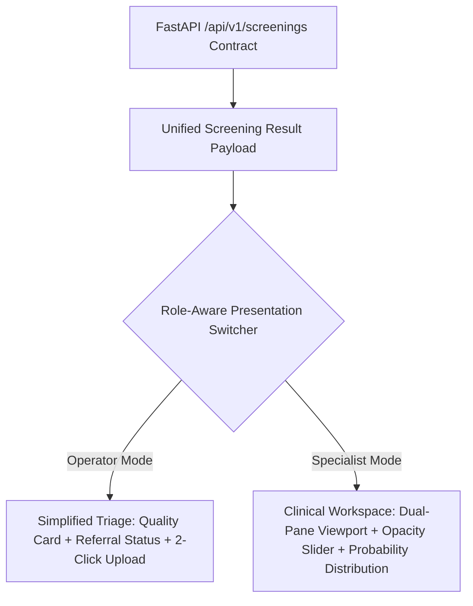

# EYERIS — Reusable Component Specifications & Architecture (Final Gate Closure)
**Subsystem**: UI/UX Component Engineering  
**Role**: Senior Healthcare UX Architect & Design Systems Lead (Member 4)  
**Project**: EYERIS — Explainable AI Diabetic Retinopathy Screening System  
**Date**: November 16, 2026  
**Status**: Final Design Approval Gate Specification (Referral Terminology Standardized)  

---

## 1. Member 4 Approved Design Decisions (Final Gate Closure)

This revised component architecture integrates the following audited decisions:
1. **Primary Showcase Component**: Elevates the **Dual-Pane Retinal Image Viewer (`DualImageViewer.jsx`)** as the primary interactive and technical centerpiece.
2. **Anatomical Visibility Guarantee**: Ensures raw preprocessed fundus images remain accessible regardless of active overlays via continuous opacity control ($0–100\%$), side-by-side viewports, and spacebar raw reveal.
3. **Causality Guardrail**: Explicitly annotates Grad-CAM components with a mandatory notice stating that activation maps indicate feature correlation density, not anatomical lesion causality.
4. **Standardized 4-Value Referral Model & Strict Precedence**:
   - *State B (Precedence 1 - Highest)*: Image Quality Failure (`QualityWarningModal.jsx`) — Halts grading; requires recapture or manual review; referral status is **`NOT_ASSESSED`**; never produces an automated referral or reassuring grade.
   - *State A (Precedence 2)*: Model Unavailability (`ModelOfflineAlert.jsx`) — Classification withheld; manual review required; referral status is **`NOT_ASSESSED`**; no negative result inferred.
   - *State C (Precedence 3)*: High Model Uncertainty (`UncertaintyAlertBadge.jsx`) — Classification withheld or marked uncertain; clinical review required; referral status is **`NOT_DETERMINED`**; high uncertainty alone never sets `INDICATED`.
   - *State D (Precedence 4 - Lowest)*: Clinical Referral (`ReferralBanner.jsx`) — Referral status is strictly **`INDICATED`** or **`NOT_INDICATED`**, and urgency tier is dictated directly by backend decision policy. The frontend never hardcodes universal urgency mappings or clinical timeframes.
5. **Multi-Channel Accessibility**: Color is never used alone (WCAG 1.4.1); every clinical severity component combines an icon shape, a text label, and a numeric grade.
6. **Button Contrast Standard**: Standardizes on `#2563EB` (luminance 0.1537) for primary buttons, guaranteeing **5.17:1** contrast with white text (`#FFFFFF`) and passing WCAG 1.4.3 AA. Focus indicators use `#3B82F6` (4.63:1 against surface, passing WCAG 1.4.11).
7. **Provisional Engineering Values**: Quality threshold 0.60 and uncertainty threshold 0.35 are documented as configurable parameters, not certified clinical standards.
8. **Role-Aware Presentation**: Operator Mode and Specialist Mode toggles adapt component density and layout without modifying the underlying decision engine.

---

## 2. Retinal Image Viewer Architecture (`DualImageViewer.jsx`) — PRIMARY TECHNICAL SHOWCASE

### 2.1 Viewport Wireframe & Layout Geometry
```
+---------------------------------------------------------------------------------------------------------+
| [Viewport Toolbar: Height 42px]                                                                         |
| Layer: [ (•) Grad-CAM Heatmap   ( ) Lesion Masks   ( ) Raw Fundus ]                                     |
| Opacity: [----------●-----] [Ex: 70%] | Zoom: [ - ] [Ex: 100%] [ + ] | [ ⟲ Reset ] | [ ↔ Side-by-Side ]  |
+---------------------------------------------------+-----------------------------------------------------+
| PANE A: True-Color Fundus Reference               | PANE B: AI Explainability Layer                     |
|                                                   |                                                     |
|                                                   |                                                     |
|             True-Color Preprocessed Fundus        |             Grad-CAM Attention Heatmap              |
|             (Macula & Optic Disc)                 |             (Class 4 / Neovascularization)          |
|                                                   |             Overlaid with Adjustable Opacity        |
|                                                   |                                                     |
|                                                   |                                                     |
+---------------------------------------------------+-----------------------------------------------------+
| [Notice: Grad-CAM heatmaps visualize feature activation density and do not establish anatomical causality]|
| (Press-and-Hold Spacebar to momentarily drop Pane B opacity to 0% and reveal raw fundus photograph)     |
+---------------------------------------------------------------------------------------------------------+
```

### 2.2 Viewport Feature Prioritization Matrix

| Viewport Capability | Architectural Description | Priority | Clinical & Technical Justification |
| :--- | :--- | :---: | :--- |
| **Grad-CAM Opacity Slider** | HTML5 range input ($0\% - 100\%$) controlling overlay canvas alpha | **Critical (First Release)** | Eliminates visual occlusion; allows clinicians to verify whether heatmaps align with true vascular lesions. |
| **Press-and-Hold Spacebar** | Keydown event listener temporarily dropping overlay alpha to 0% | **Critical (First Release)** | Enables instant visual flicker-comparison between the AI heatmap and the raw anatomical image. |
| **Synchronized Pan & Zoom** | Bi-directional canvas matrix transform linking Pane A and Pane B | **High (Phase 2)** | Guarantees exact anatomical cross-referencing during deep lesion inspection. |
| **Multi-Lesion Mask Toggles**| Independent checkboxes for exudates, hemorrhages, and microaneurysms | **High (Phase 2/3)** | Allows clinicians to isolate specific lesion classes without visual clutter. |
| **Window/Level Contrast** | Radiologist-style contrast curve adjustments | **Deferred (Post-MVP)** | Not essential for initial prototype screening demonstration. |
| **Measurement Calipers** | Digital millimeter lesion measurement calipers | **Deferred (Post-MVP)** | Requires physical camera sensor calibration parameters. |

---

## 3. Decoupled Clinical State Components & Precedence

```
+---------------------------------------------------------------------------------------------------------+
|                                    CLINICAL STATE ARCHITECTURE & PRECEDENCE                             |
+-----------------------+--------------------------+------------------------+-----------------------------+
| STATE B (PRIORITY 1)  | STATE A (PRIORITY 2)     | STATE C (PRIORITY 3)   | STATE D (PRIORITY 4)        |
| Quality Failure       | Model Unavailable        | High Uncertainty       | Referral Decision           |
+-----------------------+--------------------------+------------------------+-----------------------------+
| • Quality score < 0.60| • Model weights pending  | • Uncertainty > 0.35   | • Quality & Models Valid    |
| • Grading HALTED      | • Classification withheld| • Classification uncert| • Staging: Stated by backend|
| • Recapture required  | • Referral: NOT_ASSESSED | • Referral: NOT_DETERM.| • Referral: INDICATED /     |
| • Review if recap fail| • Review Required: TRUE  | • Review Required: TRUE|             NOT_INDICATED   |
| • Referral:NOT_ASSESS | • Urgency: Manual Review | • Urgency: Urgent Rev  | • Urgency: Stated by policy |
| • Overrides all states| • No negative inferred   | • Never sets INDICATED | • Human Review: By policy   |
+-----------------------+--------------------------+------------------------+-----------------------------+
```

### 3.1 State B: Image Quality Failure Modal (`QualityWarningModal.jsx`) — Precedence 1
- **Trigger**: `overall_quality_score < 0.60` (provisional engineering threshold) or `is_gradable == False`.
- **Presentation**: High-contrast modal `[⚠] Image Quality Insufficient for Automated Grading`.
- **Referral Status**: Explicitly **`NOT_ASSESSED`** (never reported as negative or false).
- **Content**: Specific defect breakdown (e.g. *"Corneal reflection / optical blur"*) + Action: `[ Recapture Retinal Photograph ]`. If recapture is unavailable or fails, routes to `[ Queue for Manual Review ]`.
- **Clinical Safety Rule**: Overrides all downstream processing. Never generates a reassuring grade or an automated referral from an invalid scan.

### 3.2 State A: Model Unavailability Component (`ModelOfflineAlert.jsx`) — Precedence 2
- **Trigger**: Real model weights missing (`ai_models/classifier/weights/` unharvested or service offline).
- **Presentation**: Amber status badge `[⏸] Manual Review Required` + Information Card: *"Automated classification model is currently offline. Case queued for manual ophthalmologist grading. No negative result inferred. Referral status: NOT_ASSESSED."*
- **Referral Status**: Explicitly **`NOT_ASSESSED`**.
- **Clinical Safety Rule**: Prevents unassessed cases from falsely polluting referral queues.

### 3.3 State C: Model Uncertainty Alert (`UncertaintyAlertBadge.jsx`) — Precedence 3
- **Trigger**: Epistemic uncertainty score $>0.35$ (provisional engineering threshold) or `is_uncertain == True`.
- **Presentation**: Violet badge `[🛡] High Model Uncertainty Detected — Specialist Review Required`.
- **Referral Status**: Explicitly **`NOT_DETERMINED`**.
- **Content**: Telemetry card displaying temperature-calibrated probability alongside an explicit uncertainty margin.
- **Clinical Safety Rule**: High uncertainty indicates ambiguity, not confirmed pathology; it must **never** automatically set referral to `INDICATED`.

### 3.4 State D: Clinical Referral Banner (`ReferralBanner.jsx`) — Precedence 4
- **Trigger**: Validated scan with available models and acceptable uncertainty.
- **Presentation**: Renders the exact triage output supplied by the backend decision policy:
  - *Screening Grade*: Stated by backend (e.g. `Grade 4 — Proliferative DR`, `Grade 2 — Moderate NPDR`, `Grade 0 — No DR`).
  - *Referral Indication*: Stated by backend (**`INDICATED`** / **`NOT_INDICATED`**).
  - *Clinical Urgency*: Stated by backend (`urgent`, `prompt`, `routine`, `annual_screening`).
  - *Required Human Review*: Stated by backend (`Required` / `Routine Monitoring`).
- **Clinical Safety Rule**: Frontend never invents universal clinical urgency mappings or unauthorized timeframes (e.g. consultation windows are displayed only if provided by the backend policy payload).

---

## 4. Role-Aware Presentation Modes (Operator vs. Specialist)

Both modes consume the exact same underlying pipeline contract from `/api/v1/screenings`:



- **Operator Presentation**: Optimized for rural community health nurses. Prioritizes rapid in-chair quality validation and straightforward referral instructions.
- **Specialist Presentation**: Optimized for ophthalmologists. Unlocks synchronized viewports, Grad-CAM attention controls, lesion counts, and calibrated epistemic uncertainty.

---

## 5. Form & Dropzone Components

### 5.1 Retinal Image Dropzone (`ImageDropzone.jsx`)
- **Drop Target**: 220px height, 2px dashed border (`--eyeris-border-strong`), radial camera vignette background.
- **Pre-Upload Validation**: Checks MIME type (`image/jpeg`, `image/png`) and file size ($\le 15$ MB). Displays instant file thumbnail, pixel dimensions, and clear remove button prior to API submission.

### 5.2 Bilateral Eye Selector (`EyeSelector.jsx`)
- **Interaction**: High-contrast segmented pill switch toggling between Right Eye (OD) and Left Eye (OS).
- **Multi-Channel**: Combines standard ophthalmic abbreviations (`OD` / `OS`) with full Latin names (*Oculus Dexter* / *Oculus Sinister*) and distinct selected states.
