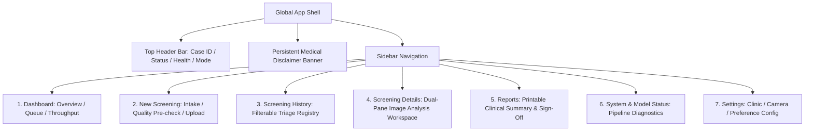

# EYERIS — UI/UX Design Research Approval Report & Strategic Blueprint
**Role**: Senior Product Designer, Healthcare UX Architect & Design Systems Lead (Member 4)  
**Project**: EYERIS — Explainable AI-Powered Diabetic Retinopathy Screening System (SIH Problem Statement PS26038)  
**Date**: November 2026  
**Status**: Formal Proposal — Awaiting Member 4 Design Approval  
**Target Branch**: `om`  

---

## 1. Executive Summary & Review Scope

This report serves as the formal **Design Approval Gate** for the user interface and user experience of **EYERIS**. Grounded in our comprehensive audit of FDA-cleared autonomous screening engines (Digital Diagnostics LumineticsCore, Eyenuk EyeArt), high-throughput field deployments (Google Health ARDA), CE-marked explainable imaging platforms (Thirona RetCAD), diagnostic PACS viewers (OHIF Viewer), and modern high-precision SaaS benchmarks (Linear, Stripe Dashboard, Vercel), this document establishes the definitive design blueprint for EYERIS.

The core objective is to deliver a clinical-grade, trust-inducing, explainable AI interface that excels across two demanding real-world environments:
1. **Frontline Rural Outreach Camps & Primary Healthcare Centers (PHCs)**: Operated by community nurses and non-specialist technicians who require zero-friction data entry, immediate in-chair image quality validation, and unambiguous referral instructions.
2. **Specialist Reading Rooms & Ophthalmology Teleconsultation Clinics**: Used by consulting ophthalmologists and retina specialists who demand dual-pane synchronized retinal viewing, layer opacity controls, Grad-CAM attention heatmaps, lesion segmentation quantification, and calibrated epistemic uncertainty metrics.

---

## 2. Competitive & Cross-Industry Reference Evaluation

### 2.1 Healthcare & Ophthalmology Platforms

| Platform | Verified Observed Pattern | Strengths to Adopt in EYERIS | Critical Limitations to Avoid |
| :--- | :--- | :--- | :--- |
| **Digital Diagnostics LumineticsCore (IDx-DR)** | Point-of-care $<30$s triage; strict immediate quality gate before patient leaves chair. | Instantaneous preventative quality gate; clear distinction between referable vs non-referable cases. | **Pure black-box output**. Hides all lesion markers and heatmaps; unacceptable for ophthalmologists auditing edge cases. |
| **Eyenuk EyeArt** | Bilateral Left Eye (OS) and Right Eye (OD) reporting; mtmDR vs vtDR disease tiering. | Bilateral clinical chart conventions; clinical urgency timeframes (e.g. prompt vs urgent referral). | Relies heavily on static multi-page PDF generation rather than interactive, zoomable web-native views. |
| **Google Health ARDA** | Frontline population screening in India/Thailand; high-volume rapid intake forms. | High-throughput intake form layout; real-time quality alerts preventing wasted clinical visits. | Operators frequently dismissed ambiguous quality warnings; lack of explicit uncertainty indicators confused operators on non-DR lesions. |
| **Thirona RetCAD** | CE-marked retinal AI; continuous quantitative risk bars with interactive lesion mask toggles. | Toggleable lesion overlays (hard exudates, hemorrhages, microaneurysms) and ICDR 0–4 scale visualization. | Integrated into heavy, closed PACS camera workstations; too complex and dense for frontline rural health workers. |
| **OHIF Viewer & Cornerstone3D** | Open-source diagnostic medical web viewer; `#0F172A` deep slate theme; synchronized viewports. | Diagnostic reading room canvas; dual-pane comparative viewports; smooth pan/zoom/windowing ergonomics. | Heavy DICOMweb infrastructure requirements; lacks native AI triage metadata layers out-of-the-box. |

### 2.2 Premium High-Precision SaaS Platforms

| Platform | Verified Observed Pattern | Strengths to Adopt in EYERIS | Risk / Incompatibility in Clinical Context |
| :--- | :--- | :--- | :--- |
| **Linear** | Ultra-clean sidebar navigation; high-density keyboard-driven tables; muted dark mode; crisp status pills. | Ergonomic sidebar layout; instant keyboard navigation (`H` for heatmap, `Esc` to reset); subtle borders and crisp typography. | Ultra-minimalist contrast can violate medical accessibility (WCAG AA); low-contrast text can cause visual fatigue in dark reading rooms. |
| **Vercel** | Clean monospace data blocks; pristine layout geometry; subtle border highlights; real-time health badges. | Real-time system and model status indicators; monospace case identifiers (`EYE-20261116-A1B2`); clean tabbed navigation. | Black/white monochromatic styling lacks the distinct color-coded semantic cues required for medical urgency and disease staging. |
| **Stripe Dashboard** | Clear data visualization hierarchy; robust empty/loading/error states; non-blocking alert toasts. | Tabular screening history; clear date/time/filter facets; defensive error states with actionable remediation. | Complex financial charts (sparklines, revenue graphs) do not translate to medical imaging; avoid decorative charts that clutter clinical data. |

---

## 3. Product Identity & Design Objectives

### 3.1 What EYERIS Is
- **A Professional Clinical Screening Support System**: Built to assist clinicians, reduce avoidable blindness, and streamline rural healthcare triage.
- **Explainable & Calibrated**: Every automated inference is accompanied by its underlying evidence (image quality scores, calibrated confidence, uncertainty scores, Grad-CAM attention maps, and segmented lesion counts).
- **Dual-Persona Ergonomic**: Seamlessly shifts between a high-throughput **Screening Operator Mode** and an in-depth **Specialist Reading Mode**.

### 3.2 What EYERIS Avoids
- **No Generic AI Dashboard Aesthetics**: No neon cyberpunk gradients, unnecessary glassmorphism, floating blur orbs, or gratuitous 3D eye animations.
- **No Fabricated Statistics or Misleading Confidence**: If a model is offline or weights are unharvested, the UI explicitly displays `"Model Unavailable — Clinical Review Required"`.
- **No Occluding Heatmaps**: Grad-CAM overlays never obscure underlying anatomical landmarks without an instant opacity slider or press-and-hold bypass.
- **No Overcrowded Widgets**: Every metric presented has a direct clinical or operational justification.

---

## 4. Information Architecture & Navigation Structure



### 4.1 Section Specifications
1. **Dashboard**:
   - *Primary User*: Clinic Administrator, Screening Operator, Reviewing Ophthalmologist.
   - *Purpose*: High-level screening throughput, pending manual review queue, recent triage cases.
   - *Key Actions*: Quick start screening, review urgent escalations, monitor daily screening targets.
2. **New Screening**:
   - *Primary User*: Screening Operator / Outreach Nurse.
   - *Purpose*: Rapid, fail-safe retinal image intake, bilateral eye assignment (OD/OS), pre-submission quality gate.
   - *Key Actions*: Drag-and-drop fundus photograph, select eye, enter pseudonymous patient ID, trigger inference.
3. **Screening History**:
   - *Primary User*: All users.
   - *Purpose*: Searchable, filterable audit registry of all screening records.
   - *Key Actions*: Filter by referral status, filter by model uncertainty, search by Case ID, export CSV.
4. **Screening Details (Clinical Inspection Workspace)**:
   - *Primary User*: Consulting Ophthalmologist & Screening Operator.
   - *Purpose*: In-depth retinal evaluation combining true-color fundus photography with Grad-CAM and lesion masks.
   - *Key Actions*: Toggle heatmaps, adjust opacity ($0-100\%$), inspect quality metrics, record ophthalmologist sign-off.
5. **Reports**:
   - *Primary User*: Ophthalmologist, Primary Care Physician, Patient.
   - *Purpose*: Formal medical documentation with `@media print` physical slip formatting and digital verification hash.
   - *Key Actions*: Print clinical report, download PDF summary, verify digital signature.
6. **System & Model Status**:
   - *Primary User*: Technical Lead, System Administrator.
   - *Purpose*: Live monitoring of FastAPI backend, PostgreSQL database, and ML model subsystems (Member 1, 2, 3).
   - *Key Actions*: Probe health, inspect model version hashes, verify processing latencies.
7. **Settings**:
   - *Primary User*: Clinic Administrator.
   - *Purpose*: Configuration of clinic name, default fundus camera model, local storage paths, and display preferences.

---

## 5. Design Comparison Matrix & Final Recommendation

| Evaluation Dimension | Direction A: Clinical-First (PACS/DICOM) | Direction B: Premium SaaS (Linear/Stripe) | Direction C: Modern Medical AI (RetCAD/ARDA) | **RECOMMENDED: EYERIS Hybrid Direction** |
| :--- | :---: | :---: | :---: | :---: |
| **Clinical Trust & Authority** | 5/5 | 3/5 | 4/5 | **5/5** (Combines diagnostic dark canvas with NHS-grade clinical framing) |
| **Workflow Usability & Speed** | 2/5 | 5/5 | 4/5 | **5/5** (Adopts Linear-grade keyboard shortcuts & 2-click upload flow) |
| **Visual Quality & Polish** | 3/5 | 5/5 | 4/5 | **5/5** (Refined slate surfaces, crisp typography, 8px grid precision) |
| **Information Density Balance** | 4/5 | 4/5 | 4/5 | **5/5** (High-density telemetry without visual overcrowding) |
| **Implementation Complexity** | High | Low | Medium | **Balanced** (Leverages pure CSS/SVG/HTML5 canvas without heavy DICOM stacks) |
| **SIH Demonstration Impact** | 3/5 | 4/5 | 4/5 | **5/5** (Visually compelling, scientifically credible, explainable) |
| **TOTAL SCORE (out of 30)** | **21/30** | **25/30** | **25/30** | **29/30** |

### Justification for the Recommended Hybrid:
- **From Direction A (PACS/Clinical)**: The **Diagnostic Slate Dark Theme** (`#0B0F17`), dual-pane synchronized viewports, and strict ICDR 5-class severity color conventions.
- **From Direction B (Premium SaaS)**: The clean persistent sidebar, high-density data tables, responsive layout geometry, tabular font formatting (`tnum`), and fluid micro-states.
- **From Direction C (Modern Medical AI)**: The interactive Grad-CAM opacity slider, segmented lesion breakdown, dual-persona mode switcher, and explicit uncertainty boundary flagging.

---

## 6. Actionable Implementation Decisions

| Decision # | Area | Approved Direction | Rationale | Priority |
| :---: | :--- | :--- | :--- | :---: |
| **DEC-01** | Color Theme | Diagnostic Dark Slate (`#0B0F17` base, `#111827` cards) | Eliminates reading room glare; enhances subtle retinal hemorrhage visibility. | Critical |
| **DEC-02** | Navigation | Collapsible Left Sidebar + Persistent Patient Header | Keeps patient context anchored while enabling rapid workflow navigation. | High |
| **DEC-03** | Image Viewer | Synchronized Dual-Pane HTML5 Canvas with Opacity Slider | Allows instant anatomical cross-checking without permanent heatmap occlusion. | Critical |
| **DEC-04** | Missing Models | Explicit `"Model Unavailable"` badges with manual review escalation | Eliminates false predictions and guarantees clinical safety integrity. | Critical |
| **DEC-05** | Quality Gate | Pre-inference card halting automated grading if quality $<0.60$ | Prevents ungradable scans from receiving reassuring false-negative grades. | Critical |
| **DEC-06** | Report Engine | Web-native view with dedicated `@media print` paper CSS | Zero-dependency physical and PDF clinical report generation. | High |

---

## 7. Approval Verdict

```
================================================================================
FINAL VERDICT: AWAITING MEMBER 4 DESIGN APPROVAL
================================================================================
The UI/UX research review, information architecture, component specifications,
and design system blueprints are fully detailed and ready for team review.
No UI implementation code has been written, and no Git modifications committed.
================================================================================
```

