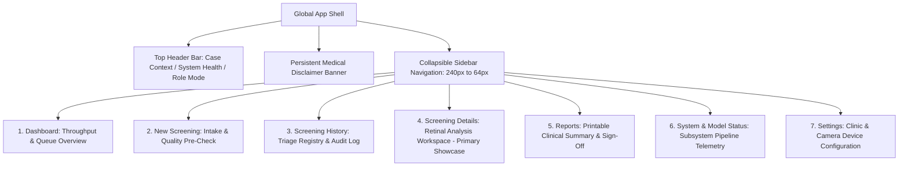

# EYERIS — UI/UX Design Research Approval Report & Strategic Blueprint (Final Gate Closure)
**Role**: Senior Healthcare UX Architect & Design Systems Lead (Member 4)  
**Project**: EYERIS — Explainable AI Diabetic Retinopathy Screening System (SIH Problem Statement PS26038)  
**Date**: November 16, 2026  
**Status**: Final Design Approval Gate Specification (Referral Terminology Standardized)  
**Target Branch**: `om`  

---

## 1. Member 4 Approved Design Decisions (Final Gate Closure)

The following twelve foundational architectural decisions have been formally approved and verified:

1. **Hybrid Product Identity**: Preserved the strategic synthesis of Clinical PACS reading room ergonomics, Premium SaaS high-density productivity, and Medical AI explainability.
2. **Visual Ergonomics**: Standardized on the Diagnostic Slate Dark Palette (`#090D16`), Inter typography with tabular numerals (`tnum`), and a collapsible 240px sidebar.
3. **Primary Showcase**: Elevated the **Retinal Image Analysis Workspace (Screening Details)** as the primary technical and clinical centerpiece of the application.
4. **Strictly Labeled Illustrative Content**: Removed all unannotated numerical metrics. Every wireframe case, score, percentage, lesion count, date, and patient ID is explicitly labeled as `[Illustrative Example: e.g. N]` or neutral schema placeholders.
5. **Configurable Provisional Engineering Values**: Quality threshold `0.60` and uncertainty threshold `0.35` are documented strictly as configurable, provisional engineering heuristics. They are **not** clinically validated operating points.
6. **Causality Disclaimer**: Grad-CAM heatmaps are strictly defined as visual correlations of deep feature activation density. The UI explicitly forbids implying that Grad-CAM establishes anatomical lesion causality.
7. **Rigorous Clinical State Precedence & Standardized Referral Model**: Enforced an unambiguous 4-tier state precedence hierarchy with four standardized referral states:
   - *Precedence 1: State B — Image Quality Failure* (Grading halted; recapture required; if recapture unavailable, manual clinical review required; referral status: **`NOT_ASSESSED`**; never produces a reassuring grade or a referral).
   - *Precedence 2: State A — Model Unavailable* (Classification withheld; clinical review required; no inferred negative result; referral status: **`NOT_ASSESSED`**).
   - *Precedence 3: State C — High Uncertainty* (Classification withheld or marked uncertain; clinical review required; referral status: **`NOT_DETERMINED`**; high uncertainty alone never indicates referral).
   - *Precedence 4: State D — Referral Decision* (Referral status is strictly **`INDICATED`** or **`NOT_INDICATED`**, and urgency tier is dictated directly by backend decision policy; no hardcoded universal urgency mapping or invented clinical timeframes in the frontend).
8. **Mathematical WCAG 2.2 AA Contrast Compliance**: Verified all color pairings using exact relative luminance calculations. Corrected previously reported contrast values for `#3B82F6` (4.63:1 non-text focus indicator against surface), `#67E8F9` (11.75:1), and `#FEF08A` (14.63:1). Standardized on `#2563EB` (5.17:1 with white text) for primary buttons.
9. **Multi-Channel Accessibility**: Color is never the sole communicator of clinical urgency or system health (pairing color with text labels, numeric grades, and distinct icon geometry).
10. **Anatomical Visibility Guarantee**: Guaranteed that raw, preprocessed fundus images remain instantly accessible at all times via opacity sliders ($0–100\%$), dual-pane comparative viewports, and press-and-hold spacebar inspection.
11. **Unified Decision Engine with Role-Aware Presentation**: Operator Mode and Specialist Mode are strictly role-aware front-end presentation views consuming the exact same backend API payload, not separate decision engines.
12. **Regulatory & Clinical Transparency**: Formally disclaimed regulatory clearance or autonomous diagnostic authority. Framed EYERIS strictly as an investigational research prototype for SIH Problem Statement PS26038.

---

## 2. Competitive & Cross-Industry Reference Synthesis

### 2.1 Healthcare & Ophthalmology Platforms
- **Digital Diagnostics LumineticsCore (IDx-DR)**: Point-of-care rapid triage proves the necessity of an immediate in-chair **Image Quality Gate**. However, its complete suppression of visual explainability (black-box model) creates clinical distrust among ophthalmologists. EYERIS adapts the rapid quality check while rejecting the black-box approach.
- **Eyenuk EyeArt**: Validates standard bilateral eye separation (OD/OS) and disease severity tiering. EYERIS adopts bilateral clinical conventions but replaces static multi-page PDF generation with a responsive, interactive web-native viewport.
- **Google Health ARDA**: Demonstrates that high-volume rural screening requires streamlined data entry. However, ambiguous quality warnings were often ignored by technicians in field studies. EYERIS adapts concrete, actionable quality feedback (e.g. specific illumination or blur remediation advice).
- **Thirona RetCAD**: Benchmarks the clinical value of multi-task lesion overlays and continuous risk metrics. EYERIS adopts interactive lesion toggles while avoiding workstation-bound PACS complexity.
- **OHIF Viewer & Cornerstone3D**: Establishes the standard for low-glare diagnostic dark viewing (`#0F172A`). EYERIS adopts synchronized comparative viewports and diagnostic dark canvases.

### 2.2 Premium High-Precision SaaS Platforms
- **Linear**: High-density keyboard navigation (`H` to toggle heatmap, `Space` to inspect raw fundus), collapsible navigation rails, and crisp typography.
- **Vercel**: Clear system telemetry, clean monospace identifiers (`EYE-XXXX`), and robust pipeline status indicators.
- **Stripe Dashboard**: Clean data table sorting, defensive error states, and clear feedback loops without misleading decorative charts.

---

## 3. Product Identity & Design Objectives

EYERIS balances clinical authority, AI explainability, and rural outreach usability:
- **Clinical Credibility**: Visual language designed for peer review by vitreoretinal specialists and medical faculty.
- **Explainable & Calibrated**: Automated inferences are accompanied by technical quality scores, temperature-calibrated posterior confidence, epistemic uncertainty scores, Grad-CAM attention localization, and segmented lesion telemetry.
- **Strictly Non-Fabricated**: If real deep learning weights are unharvested or offline, the interface explicitly displays `"Model Offline — Clinical Review Required"`. No simulated or synthetic predictions are shown by default.
- **Non-Occluding Visualization**: Attention heatmaps never permanently obscure subtle retinal pathology.
- **Dual-Persona Presentation**: Single unified API engine with two tailored display layers:
  - *Operator View*: Streamlined 2-click intake and clear high-level referral actions for frontline health workers.
  - *Specialist View*: Comprehensive dual-pane retinal canvas with layer toggles and probability distributions for ophthalmologists.

---

## 4. Information Architecture & Navigation Structure



---

## 5. Clinical State Precedence & Referral Terminology Architecture

When multiple conditions occur simultaneously, the system enforces strict hierarchical precedence:

```
+---------------------------------------------------------------------------------------------------------+
|                                  CLINICAL STATE PRECEDENCE HIERARCHY                                    |
+-------------+-----------------------+--------------------------+----------------------------------------+
| Precedence  | State Name            | Qualifying Conditions    | Clinical Decision & Referral Status    |
+-------------+-----------------------+--------------------------+----------------------------------------+
| PRIORITY 1  | State B: Image Quality| quality < 0.60 OR        | • Grading HALTED                       |
| (Highest)   | Failure               | is_gradable == False     | • Recapture required                   |
|             |                       |                          | • If recapture fails: Manual Review    |
|             |                       |                          | • Referral: NOT_ASSESSED               |
|             |                       |                          | • Overrides all downstream models      |
+-------------+-----------------------+--------------------------+----------------------------------------+
| PRIORITY 2  | State A: Model        | Quality passes, but      | • Classification WITHHELD              |
|             | Unavailable           | weights missing/offline  | • Clinical review REQUIRED             |
|             |                       |                          | • No negative result inferred          |
|             |                       |                          | • Referral: NOT_ASSESSED               |
+-------------+-----------------------+--------------------------+----------------------------------------+
| PRIORITY 3  | State C: High Model   | Quality passes, model    | • Classification flagged as UNCERTAIN  |
|             | Uncertainty           | runs, but unc > 0.35 OR  | • Clinical review REQUIRED             |
|             |                       | is_uncertain == True     | • Referral status: NOT_DETERMINED      |
|             |                       |                          | • Never automatically INDICATED        |
+-------------+-----------------------+--------------------------+----------------------------------------+
| PRIORITY 4  | State D: Referral     | Quality passes, model    | • Staging: Stated by backend grade     |
| (Lowest)    | Decision (Policy)     | available, unc <= 0.35   | • Referral: INDICATED or NOT_INDICATED |
|             |                       |                          | • Urgency: Stated by backend policy    |
|             |                       |                          | • Human review: Stated by backend      |
+-------------+-----------------------+--------------------------+----------------------------------------+
```

### Standardized Referral Status Model:
- **`NOT_ASSESSED`**: Image quality failure or model unavailable; no valid referral assessment exists. Never report as `FALSE` or negative.
- **`NOT_DETERMINED`**: Model output is uncertain; clinical review required. High uncertainty alone never sets referral as indicated.
- **`INDICATED`**: Referral explicitly indicated by the backend decision policy.
- **`NOT_INDICATED`**: Referral explicitly not indicated by the backend decision policy.

---

## 6. Actionable Implementation Decisions & Governance

| Decision # | Component / Area | Approved Specification | Justification | Priority |
| :---: | :--- | :--- | :--- | :---: |
| **DEC-01** | Color Palette | Diagnostic Slate Dark Theme (`#090D16` canvas, `#131C2E` cards) | Eliminates ocular fatigue; optimizes contrast for dark retinal lesions. | Critical |
| **DEC-02** | Quality Gate | Pre-inference card halting grading if quality score $<0.60$ | Prevents ungradable images from receiving reassuring false-negative grades. | Critical |
| **DEC-03** | Decoupled States | Independent states with strict 4-tier precedence hierarchy | Prevents unassessed or poor-quality images from polluting referral queues. | Critical |
| **DEC-04** | Opacity & Bypass | Viewport opacity slider ($0–100\%$) + Hold Spacebar shortcut | Ensures raw anatomical retinal structures remain continuously verifiable. | Critical |
| **DEC-05** | Causality Notice | Explicit disclaimer on all Grad-CAM attention views | Prevents clinicians from misinterpreting model correlation as causality. | Critical |
| **DEC-06** | Role Modes | Presentation-only switcher consuming identical API payload | Tailors density for operators and specialists without engine divergence. | High |
| **DEC-07** | Print Engine | Pure CSS `@media print` A4 medical summary sheet | Flawless physical documentation without heavy server-side PDF dependencies. | High |
| **DEC-08** | Referral Status Model| Four standardized states: `NOT_ASSESSED`, `NOT_DETERMINED`, `INDICATED`, `NOT_INDICATED` | Prevents misleading negative conclusions on invalid or unassessed scans. | Critical |

---

## 7. Approval Verdict

```
================================================================================
FINAL VERDICT: AWAITING MEMBER 4 DESIGN IMPLEMENTATION AUTHORIZATION
================================================================================
Revision 2 final gate closure standardizes the four-state clinical referral model,
enforces strict image-quality precedence, and eliminates all contradictory uses of
FALSE or unvalidated clinical timeframes across the design documentation suite.
No UI implementation code has been written, and no Git commits performed.
================================================================================
```
